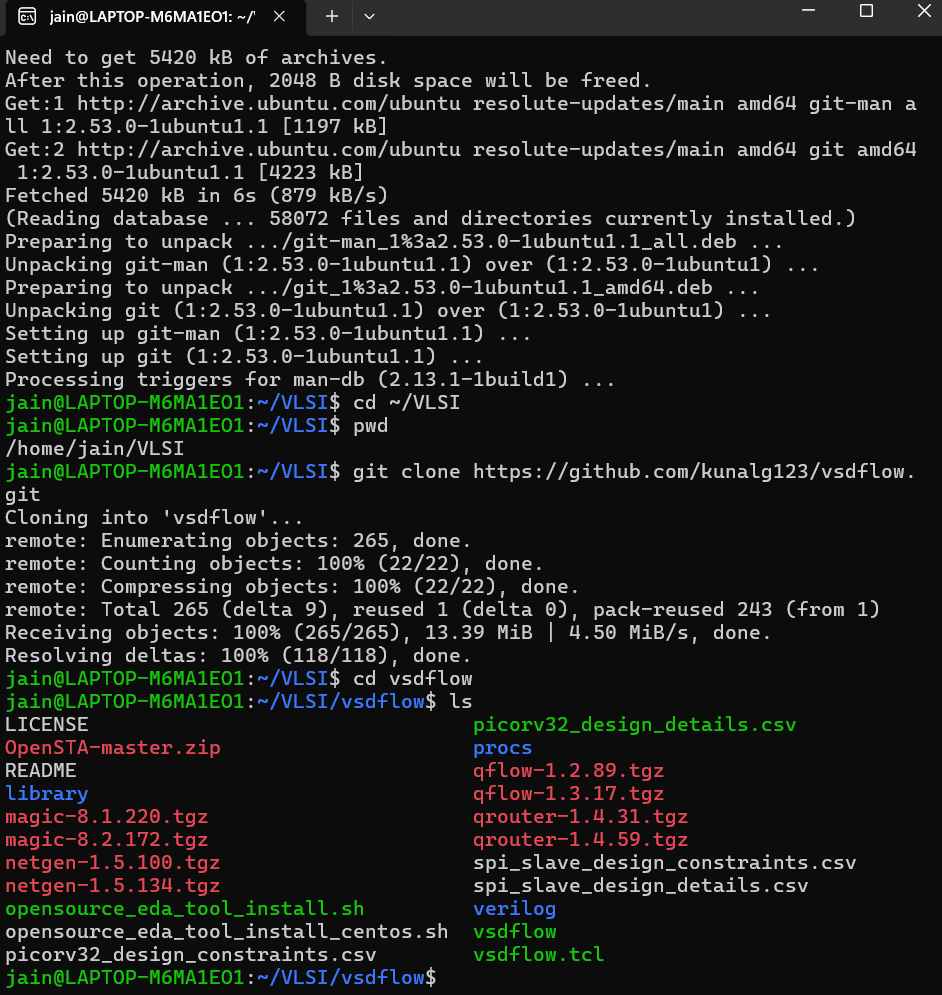
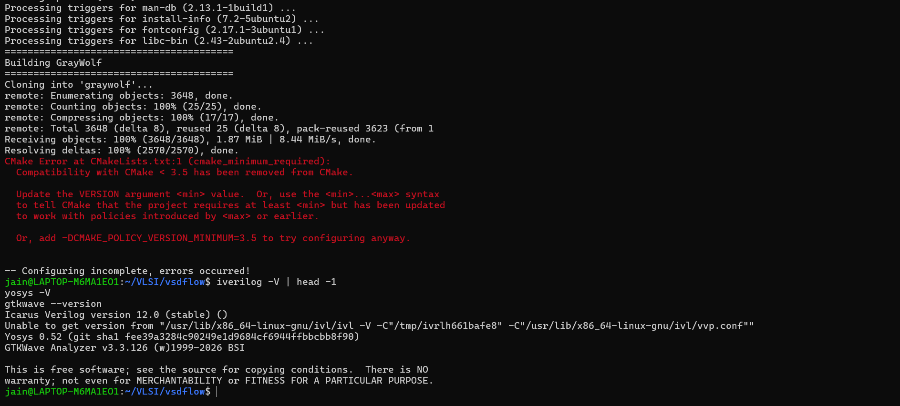
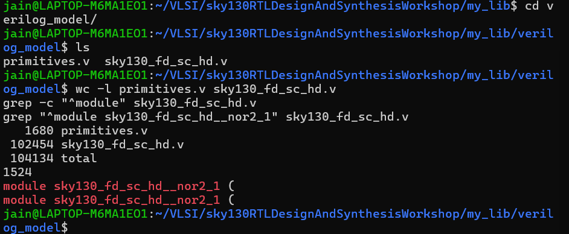
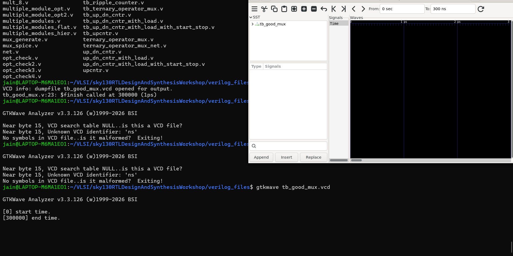
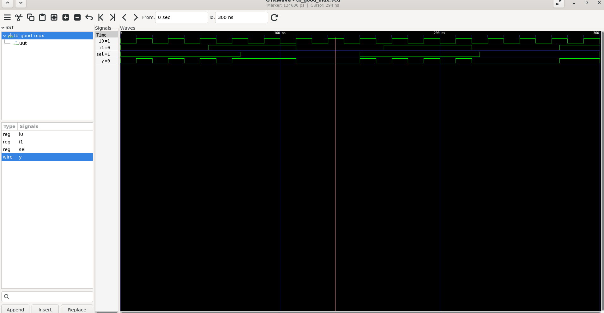
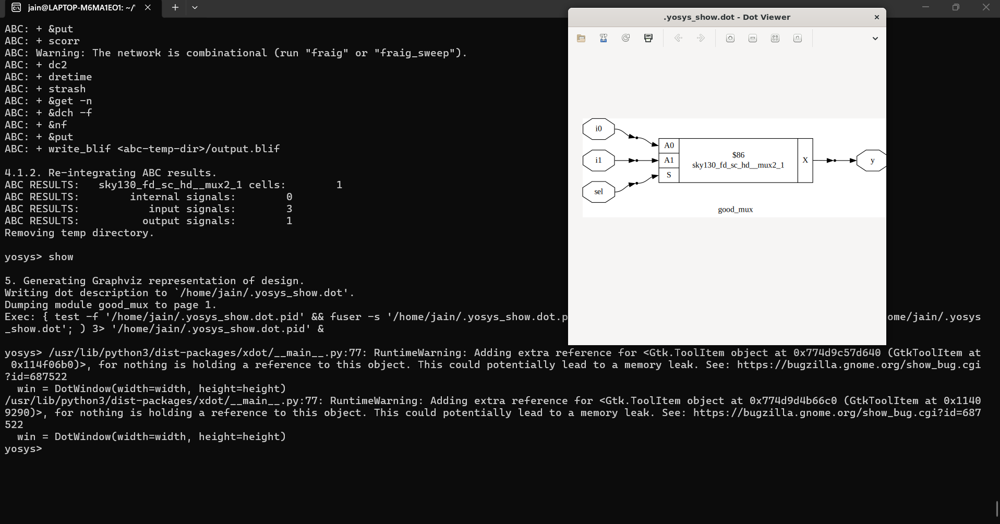
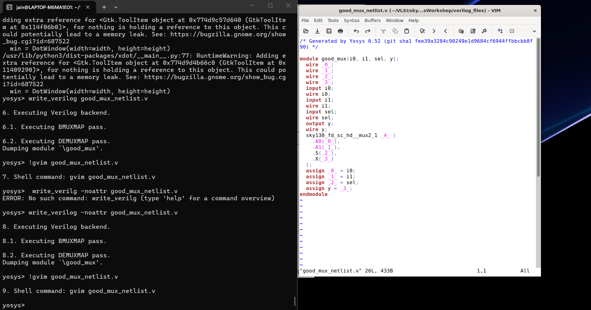

# SKY130 RTL Design and Synthesis Workshop – Day 1

This document records the work completed on Day 1: setting up the open-source toolchain, simulating a 2:1 multiplexer with **Icarus Verilog**, viewing its waveforms in **GTKWave**, and synthesizing it into a gate-level netlist with **Yosys** using the **SkyWater 130 nm (Sky130)** standard-cell library.

## Contents

1. [Tools and Environment](#tools-and-environment)
2. [Concepts Covered](#concepts-covered)
3. [Environment Setup](#environment-setup)
4. [Simulating a 2:1 MUX](#simulating-a-21-mux)
5. [Synthesis with Yosys](#synthesis-with-yosys)
6. [Understanding the Liberty (.lib) File](#understanding-the-liberty-lib-file)
7. [Troubleshooting](#troubleshooting)
8. [Acknowledgements](#acknowledgements)

---

## Tools and Environment

| Tool | Version | Purpose |
|------|---------|---------|
| Icarus Verilog (`iverilog`) | 12.0 (stable) | RTL and gate-level simulation |
| GTKWave | v3.3.126 | Waveform viewer |
| Yosys | 0.52 | Logic synthesis |
| Sky130 `sky130_fd_sc_hd` | tt_025C_1v80 | Standard-cell library |
| gVim | - | Code editor |
| OS | Ubuntu on WSL | Development environment |

---

## Concepts Covered

### Simulator, Design and Testbench

- **Simulator:** the tool that checks an RTL design against its specification by simulating it. Here, `iverilog`.
- **Design:** the Verilog code (one or more modules) that implements the required functionality.
- **Testbench:** the setup that applies stimulus (test vectors) to the design and checks its behavior. It has no ports of its own.

A testbench contains a **stimulus generator** that drives the design's primary inputs and a **stimulus observer** that monitors its primary outputs.

### How a simulator works

The simulator watches for **changes on the inputs**. When an input changes, the output is re-evaluated. If no input changes, the output does not change.

### Verilog simulation flow

```
Design ─────┐
            ├──► iverilog ──► a.out ──► VCD file ──► GTKWave
Testbench ──┘
```

`VCD` stands for *Value Change Dump*. The simulator writes each signal's value changes to this file, and GTKWave renders them as waveforms.

---

## Environment Setup

### 1. Create the workspace and install Git

```bash
mkdir VLSI
cd ~/VLSI
sudo apt-get update
sudo apt-get install -y git
```

| Command | Purpose |
|---------|---------|
| `sudo` | Runs the command as administrator |
| `apt-get` | Ubuntu's package manager |
| `update` | Refreshes the list of available software and versions |
| `install -y` | Installs a package and auto-confirms the prompt |

### 2. Clone the VSD flow repository

```bash
cd ~/VLSI
git clone https://github.com/kunalg123/vsdflow.git
cd vsdflow
ls
```



### 3. Install the open-source EDA tools

```bash
sudo chmod +x opensource_eda_tool_install.sh
sudo ./opensource_eda_tool_install.sh
```

`chmod +x` gives the script permission to run as a program. The script installs the open-source chip design tools (Icarus Verilog, Yosys, GTKWave, and others).

Verify the installation:

```bash
iverilog -V | head -1
yosys -V
gtkwave --version
```



### 4. Clone the workshop repository

```bash
cd ~/VLSI
git clone https://github.com/kunalg123/sky130RTLDesignAndSynthesisWorkshop.git
cd sky130RTLDesignAndSynthesisWorkshop
ls
```

| Folder | Contents |
|--------|----------|
| `lib/` | Liberty timing library (`sky130_fd_sc_hd__tt_025C_1v80.lib`) |
| `my_lib/verilog_model/` | Verilog models of the standard cells: `primitives.v`, `sky130_fd_sc_hd.v` |
| `verilog_files/` | All Verilog designs and testbenches used in the labs |


### 5. Library statistics

```bash
cd my_lib/verilog_model
wc -l primitives.v sky130_fd_sc_hd.v
grep -c "^module" sky130_fd_sc_hd.v
```

| File | Lines |
|------|-------|
| `primitives.v` | 1,680 |
| `sky130_fd_sc_hd.v` | 102,454 |

The `sky130_fd_sc_hd.v` model defines **1,524 modules** (standard cells).



---

## Simulating a 2:1 MUX

### Design: `good_mux.v`

```verilog
module good_mux (input i0, input i1, input sel, output reg y);
always @ (*)
begin
    if (sel)
        y <= i1;
    else
        y <= i0;
end
endmodule
```

### Testbench: `tb_good_mux.v`

The testbench instantiates the Unit Under Test (UUT), dumps the waveform to `tb_good_mux.vcd`, initializes the inputs, and ends the simulation after 300 ns with `$finish`.


### Run the simulation

```bash
cd verilog_files
iverilog good_mux.v tb_good_mux.v
./a.out
gtkwave tb_good_mux.vcd
```

- `iverilog good_mux.v tb_good_mux.v` compiles the design and testbench into `a.out`.
- `./a.out` runs the simulation and dumps the `.vcd` file.
- `gtkwave tb_good_mux.vcd` opens the waveform viewer.

### View the waveform in GTKWave

1. In the **SST** panel, click `tb_good_mux`. Its signals (`i0`, `i1`, `sel`, `y`) appear below.
2. Select the signals and add them to the wave window (**Append**).
3. Use **Zoom Fit** to see the full waveform.
4. Use the **Zoom to Start / Zoom to End** buttons and the forward and backward transition buttons to step through edges.





### Observed behavior

| `sel` | Output `y` |
|-------|------------|
| `0` | follows `i0` |
| `1` | follows `i1` |

This confirms the RTL functions as a 2:1 multiplexer.

---

## Synthesis with Yosys

### What is synthesis?

**Synthesis** converts RTL into a **gate-level netlist**. The design is translated into logic gates, and the connections between those gates are captured in a file called the **netlist**.

- **Yosys** is the synthesizer used here.
- The `.lib` file provides the cells that Yosys maps the design onto.

```
Design ──► read_verilog ─┐
                         ├──► Yosys ──► write_verilog ──► Netlist
.lib   ──► read_liberty ─┘
```

### Synthesis flow

```bash
yosys
```

```tcl
# 1. Read the technology library
read_liberty -lib ../lib/sky130_fd_sc_hd__tt_025C_1v80.lib

# 2. Read the design
read_verilog good_mux.v

# 3. Synthesize with good_mux as the top module
synth -top good_mux

# 4. Map to the Sky130 standard cells with ABC
abc -liberty ../lib/sky130_fd_sc_hd__tt_025C_1v80.lib

# 5. View the synthesized logic
show
```

### Synthesis result

| Item | Value |
|------|-------|
| Mapped cell | `sky130_fd_sc_hd__mux2_1` |
| Cell count | 1 |
| Input signals | 3 (`i0`, `i1`, `sel`) |
| Output signals | 1 (`y`) |
| Internal signals | 0 |

`show` generates a graphical (Graphviz) representation of the realized logic: a single `mux2_1` cell with inputs `A0`, `A1`, `S` and output `X`.



### Write the netlist

```tcl
write_verilog good_mux_netlist.v
!gvim good_mux_netlist.v

# Cleaner output without attributes
write_verilog -noattr good_mux_netlist.v
!gvim good_mux_netlist.v
```



The generated netlist instantiates one `sky130_fd_sc_hd__mux2_1` cell with `A0`, `A1`, `S` and `X` connected to the module ports.

### Verify the synthesis (gate-level simulation)

The synthesized netlist is simulated with the **same testbench** used for RTL simulation. The cell models from `my_lib/verilog_model` are included so the simulator knows what `sky130_fd_sc_hd__mux2_1` is.

```bash
iverilog ../my_lib/verilog_model/primitives.v \
         ../my_lib/verilog_model/sky130_fd_sc_hd.v \
         good_mux_netlist.v tb_good_mux.v
./a.out
gtkwave tb_good_mux.vcd
```

> **Note:** The set of primary inputs and primary outputs stays the same between the RTL design and the synthesized netlist, so the same testbench can be reused. The output observed during netlist simulation should match the output observed during RTL simulation.

---

## Understanding the Liberty (.lib) File

### What is a `.lib`?

A collection of logical modules that includes basic logic gates such as AND, OR and NOT, in **different flavors of the same gate**:

- 2-input AND gate: slow, medium, fast
- 3-input AND gate: slow, medium, fast
- 4-input AND gate: slow, medium, fast

The `.lib` contains the standard cells needed to implement any Boolean logic function.

### Why do we need different flavors of a gate?

For a path between two flip-flops, the **combinational delay** sets the maximum operating speed of the circuit:

```
T_clk > T_clk-to-q(A) + T_comb + T_setup(B)
F_clk(max) = 1 / T_clk(min)
```

where `T_comb` is the propagation delay of the combinational logic. Data must travel from flop A to flop B within one clock cycle.

### Faster cells vs slower cells

**Why faster cells?** A digital gate drives a capacitive load. The faster the load charges and discharges, the lower the cell delay. To charge or discharge quickly, the cell needs more current, which means **wider transistors**. Wider transistors give less delay but cost **more area and power**.

**Why slower cells?** To avoid **hold violations**. The capture flop must not see new data before its hold requirement is met. We need fast cells to meet the required performance and slow cells to meet hold. The collection of both forms the `.lib`.

| | Fast cells | Slow cells |
|--|-----------|-----------|
| Transistors | Wide | Narrow |
| Delay | Less | More |
| Area | More | Less |
| Power | More | Less |

Fast cells do not come free: they come at the penalty of area and power.

### Selecting the right cells

The synthesizer must be guided to select the flavor of cell that is optimal for the logic implementation.

- **Too many fast cells:** bad circuit in terms of power and area, and potential hold-time violations.
- **Too many slow cells:** a sluggish circuit that may not meet the performance need.

This guidance is given to the synthesizer as **constraints**.

---

## Troubleshooting

| Issue | Cause / Fix |
|-------|-------------|
| `CMake Error: Compatibility with CMake < 3.5 has been removed` while building GrayWolf | The newer CMake rejects the old minimum version. Add `-DCMAKE_POLICY_VERSION_MINIMUM=3.5` to the cmake command, or update the `cmake_minimum_required` line in the project's `CMakeLists.txt`. |
| `Unable to get version from ... ivl` after `iverilog -V` | Cosmetic message. The version line (`Icarus Verilog version 12.0`) is still printed. |
| GTKWave: `is this a VCD file? / No symbols in VCD file..is it malformed?` | The file passed to GTKWave was not a valid VCD. Run `gtkwave tb_good_mux.vcd` on the file generated by the simulation. |
| `ERROR: No such command: write_verilg` in Yosys | Typo. The command is `write_verilog`. |
| `RuntimeWarning: Adding extra reference for Gtk.ToolItem` when running `show` | Harmless warning from the `xdot` viewer. |

---

## Acknowledgements

- [VSD (VLSI System Design)](https://www.vlsisystemdesign.com/) for the workshop material
- [kunalg123/sky130RTLDesignAndSynthesisWorkshop](https://github.com/kunalg123/sky130RTLDesignAndSynthesisWorkshop) for the labs and library files
- [SkyWater PDK](https://github.com/google/skywater-pdk), [Yosys](https://github.com/YosysHQ/yosys), [Icarus Verilog](https://github.com/steveicarus/iverilog) and [GTKWave](https://gtkwave.sourceforge.net/)
