# RTL Sythesis and Design -DAY 3

Notes and lab results for **combinational** and **sequential logic optimization**, using Yosys and the `sky130_fd_sc_hd` standard cell library.


---

## Table of Contents
1. [Theory](#1-theory)
2. [Lab: Combinational Optimization](#2-lab-combinational-optimization)
3. [Lab: Sequential Optimization](#3-lab-sequential-optimization)
4. [Unused Output Optimization](#4-unused-output-optimization-counter_opt)
5. [Yosys Command Reference](#5-yosys-command-reference)

---

## 1. Theory

### 1.1 Combinational Logic Optimization
Squeeze the logic to get the most optimized design, which saves **area** and **power**.

Techniques:
- **Constant propagation** (direct optimization)
- **Boolean logic optimization**
  - K-map
  - Quine–McCluskey

#### Constant Propagation – Example
For `Y = ((A·B) + C)'`:
- If `A` is grounded, the AND output is `0`, so `Y = C'`.
- The circuit reduces to a single inverter.

| | Transistors |
|---|---|
| Original (AND-OR-INVERT) | 6 MOS |
| After constant propagation (inverter) | 2 MOS |

The constant `0` on `A` was propagated down the logic, giving the most optimized realization with less area and less power.

#### Boolean Logic Optimization – Example
```verilog
assign y = a ? (b ? c : (c ? a : b)) : (c ? 1 : c);
```
Simplifying with Boolean algebra gives:

```
y = a'c' + ac  =  a ⊙ c     (XNOR of a and c)
```

### 1.2 Sequential Logic Optimization
- **Basic**
  - Sequential constant propagation
- **Advanced**
  - State optimization
  - Retiming
  - Sequential logic cloning (floorplan aware synthesis)

#### Sequential Constant Propagation
- **D flip-flop with async reset (D tied to constant):**
  - When reset = 1, Q = 0. With no reset, Q = 0, so D = 0.
  - The flop output is always a constant, so the logic after it simplifies. For example `Y = (A·Q)' = A' + Q' = 1`, so **Y = 1 always**.
- **D flip-flop with async set:**
  - When set is applied, Q = 1. With no set, Q follows the clock edge and is 0.
  - Q goes to 1 **asynchronously** w.r.t. the clock, and stays until the next clock edge after set goes low.
  - So Q is **not** a constant, and the logic **cannot** be optimized.

> Rule: only a flop whose output is a **constant for every input** can be optimized away. Otherwise the flop and its logic are retained.

#### State Optimization
Optimization of **unused states**.

#### Cloning (physical aware synthesis)
Duplicate a flop so that each copy drives a nearby load. This reduces large routing delay from the original flop to its far-apart destinations (B and C).

#### Retiming
Move combinational logic across flops to balance the stage delays and raise the clock frequency (assuming delay and setup time = 0).

- Before retiming: the worst stage limits the clock, effectively **200 MHz**.
- After retiming: the stages are balanced, giving segments of roughly **250 MHz** and **333 MHz**.

---

## 2. Lab: Combinational Optimization

Files are in `verilog_files/`. Check them with `ls *opt*`.

### 2.1 Basic flow (`opt_check`)
```
yosys
read_liberty -lib ../lib/sky130_fd_sc_hd__tt_025C_1v80.lib
read_verilog opt_check.v
synth -top opt_check
opt_clean -purge
abc -liberty ../lib/sky130_fd_sc_hd__tt_025C_1v80.lib
show
```

#### `opt_check`: `y = a ? b : 0`
Mux reduces to `y = a'·0 + a·b = ab`, an **AND gate**.

**SS 25.1** – synthesized to `sky130_fd_sc_hd__and2_0`

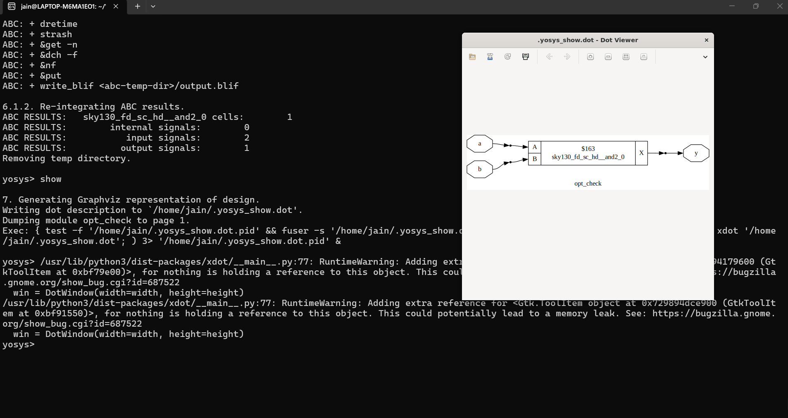

#### `opt_check2`: `y = a ? 1 : b`
Mux reduces to `y = a'b + a = a + b`, an **OR gate**.

**SS 25.2** – synthesized to `sky130_fd_sc_hd__or2_0`

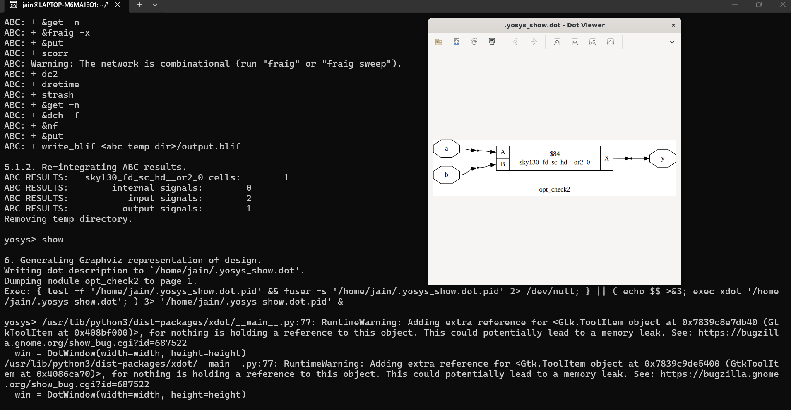

### 2.2 Three-level and multi-module examples

#### `opt_check3`: `y = a ? (c ? b : 0) : 0`
`y = a'·0 + a(c'·0 + cb) = 0 + abc = abc`, a **3-input AND**.

**SS 26.1** – synthesized to `sky130_fd_sc_hd__and3_1`

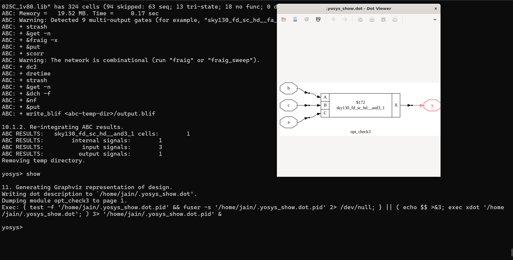

#### `opt_check4`
**SS 26.2** – synthesized to `sky130_fd_sc_hd__xnor2_1`. Input `b` is unused, so it is left dangling (`$b`).

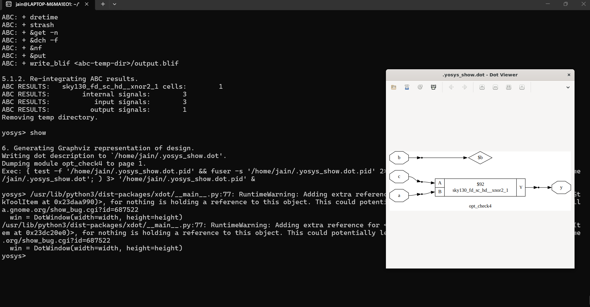

#### `multiple_module_opt.v`
Contains several sub-modules. **Flatten** the design first so the optimizer can see across module boundaries, then clean up:
```
flatten
opt_clean -purge
```
**SS 26.3** – optimized to a single `sky130_fd_sc_hd__a21o_1` cell

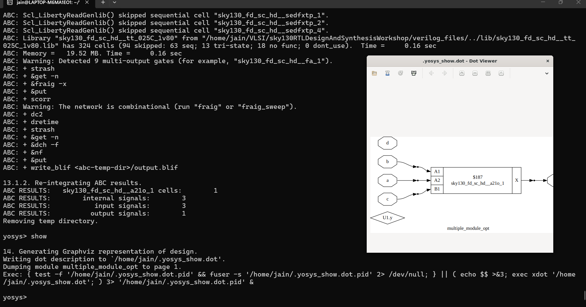

#### `multiple_module_opt2.v`
Same flow (`flatten`, `opt_clean -purge`).

**SS 26.4** – the output reduces to constant `1'b0`. No logic cells remain, only the constant driver. Inputs a, b, c, d are unused.

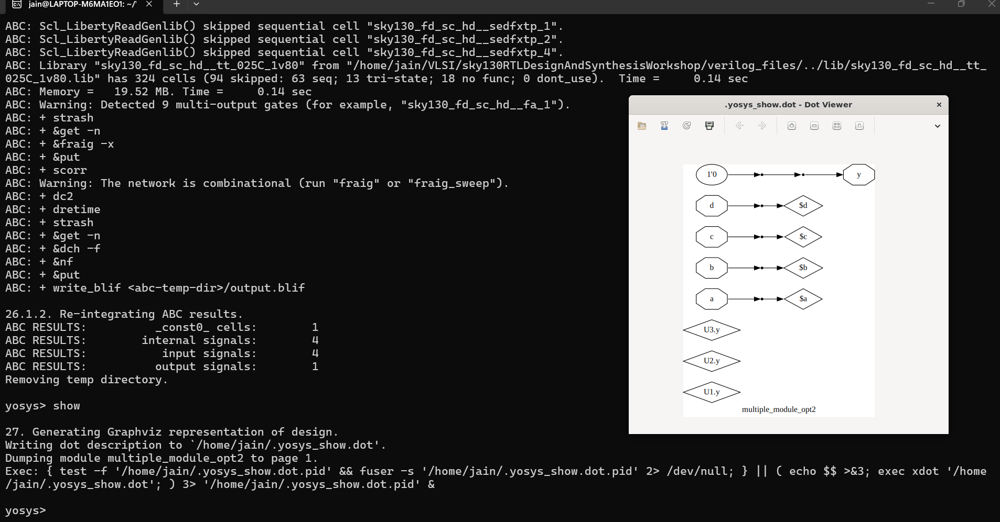

---

## 3. Lab: Sequential Optimization

Check the files with `ls *df*const*`. View two files side by side with `gvim dff_const1.v -o dff_const2.v`.

### 3.1 `dff_const1` – flop is **kept**
```verilog
module dff_const1(input clk, input reset, output reg q);
always @(posedge clk, posedge reset)
begin
    if (reset)
        q <= 1'b0;
    else
        q <= 1'b1;
end
endmodule
```
Reset drives Q to `0`, otherwise Q becomes `1`. Q is **not** constant, so the flop cannot be removed.

**SS 27.1** – `dff_const1.v` and `dff_const2.v` side by side in gvim

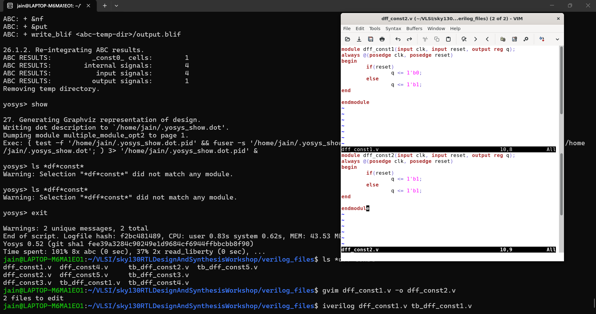

**Simulation**
```
iverilog dff_const1.v tb_dff_const1.v
./a.out
gtkwave tb_dff_const1.vcd
```
**SS 27.2** – waveform: Q is 0 while reset = 1, then goes to 1 on the next clock edge after reset is released.

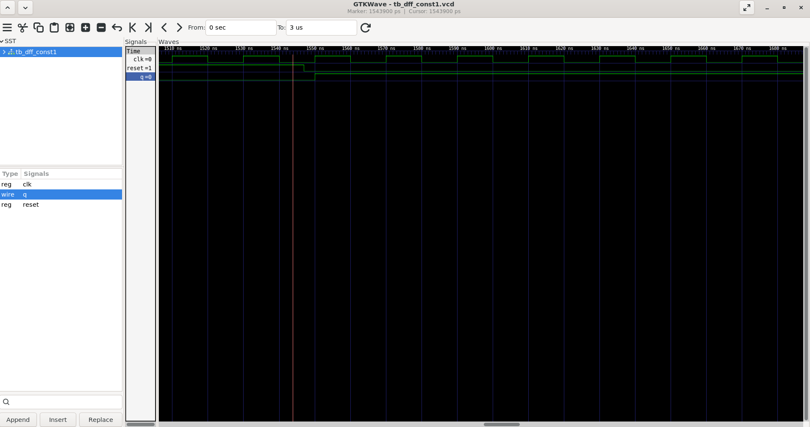

**Synthesis**
```
yosys
read_liberty -lib ../lib/sky130_fd_sc_hd__tt_025C_1v80.lib
read_verilog dff_const1.v
synth -top dff_const1
dfflibmap -liberty ../lib/sky130_fd_sc_hd__tt_025C_1v80.lib
abc -liberty ../lib/sky130_fd_sc_hd__tt_025C_1v80.lib
show
```
**SS 27.4** – maps to a `sky130_fd_sc_hd__dfrtp_1` flop with `D = 1'b1`, plus a `clkinv_1` inverter on reset (active-low `RESET_B`). The flop is retained.

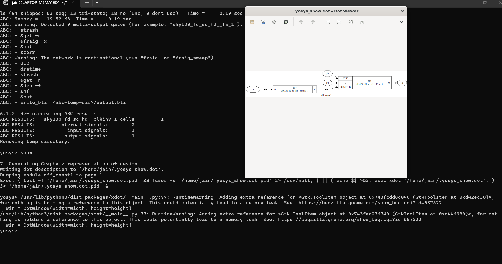

### 3.2 `dff_const2` – flop is **removed**
```verilog
module dff_const2(input clk, input reset, output reg q);
always @(posedge clk, posedge reset)
begin
    if (reset)
        q <= 1'b1;
    else
        q <= 1'b1;
end
endmodule
```
Q is `1` in both branches, so it is a constant.

**SS 27.3** – waveform: Q stays constant at 1 regardless of reset.

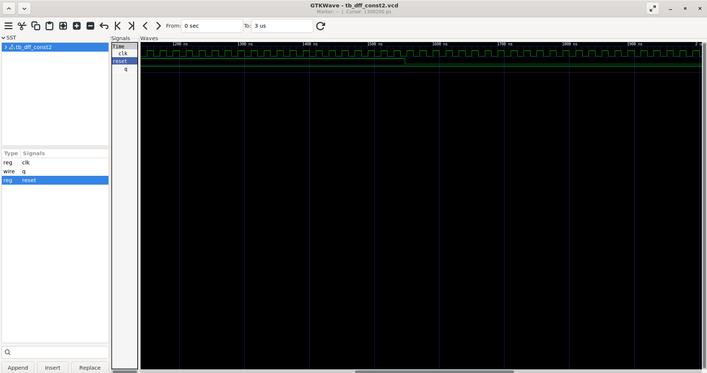

**Synthesis:** same flow as above, but **do not use `dfflibmap`**, because it is not needed when no flop is left (done in class on the board).

**SS 28.1** – 0 cells. Q is tied directly to `1'b1`; `reset` and `clk` are unused. ABC reports "nothing to map".

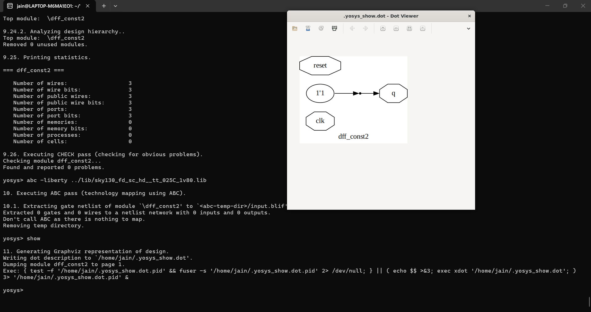

### 3.3 `dff_const3` – two flops, **both kept**
```verilog
module dff_const3(input clk, input reset, output reg q);
reg q1;
always @(posedge clk, posedge reset)
begin
    if (reset)
    begin
        q  <= 1'b1;
        q1 <= 1'b0;
    end
    else
    begin
        q1 <= 1'b1;
        q  <= q1;
    end
end
endmodule
```
Reset sets `q = 1` and `q1 = 0`. After reset, `q1 = 1` and `q` follows `q1` one cycle later. Q briefly drops to 0 and then returns to 1, so it is **not** constant.

**SS 29.1** – source code in gvim

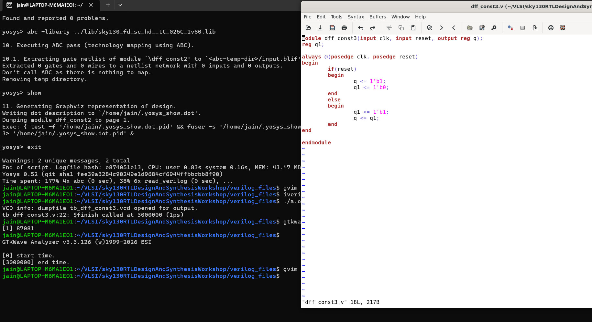

**Simulation**
```
iverilog dff_const3.v tb_dff_const3.v
./a.out
gtkwave tb_dff_const3.vcd
```
**SS 29.2** – waveform: Q dips to 0 for a few clock cycles after reset is released, then goes to 1.

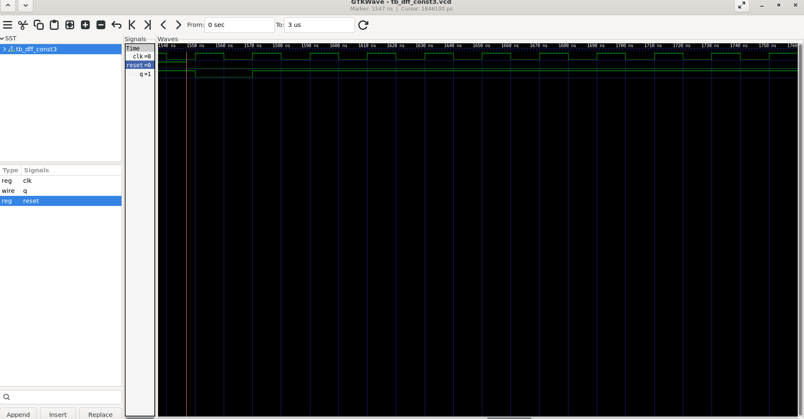

**Synthesis**
```
yosys
read_liberty -lib ../lib/sky130_fd_sc_hd__tt_025C_1v80.lib
read_verilog dff_const3.v
synth -top dff_const3
dfflibmap -liberty ../lib/sky130_fd_sc_hd__tt_025C_1v80.lib
abc -liberty ../lib/sky130_fd_sc_hd__tt_025C_1v80.lib
show
```
**SS 29.3** – two flops are retained:
- `dfrtp_1` (async reset) for `q1`
- `dfstp_2` (async set) for `q`
- two `clkinv_1` inverters on reset

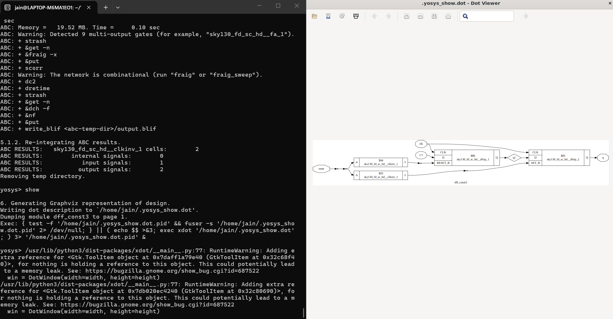

### 3.4 `dff_const4` – flops **optimized to a constant**
```verilog
module dff_const4(input clk, input reset, output reg q);
reg q1;
always @(posedge clk, posedge reset)
begin
    if (reset)
    begin
        q  <= 1'b1;
        q1 <= 1'b1;
    end
    else
    begin
        q1 <= 1'b1;
        q  <= q1;
    end
end
endmodule
```
Both `q` and `q1` are `1` in every case, so Q is constant 1.

**SS 29.4** – source code in gvim. Synthesis finds nothing to map ("Don't call ABC as there is nothing to map").

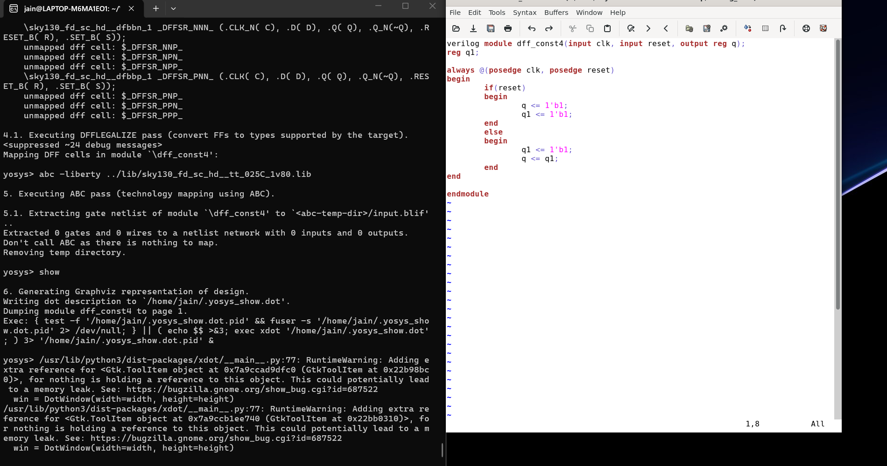

**SS 29.5** – GTKWave screenshot for this experiment

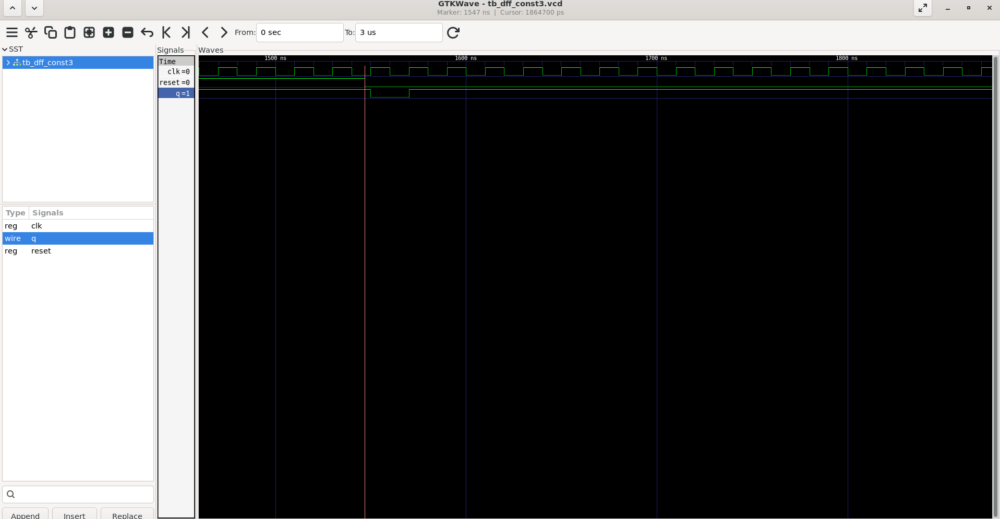

> Note: the window title in this screenshot is `tb_dff_const3.vcd`, and the waveform (Q dips to 0 for a few cycles, then 1) matches `dff_const3`, not `dff_const4`. For `dff_const4` Q should stay at a constant 1. Re-run `iverilog dff_const4.v tb_dff_const4.v`, `./a.out`, `gtkwave tb_dff_const4.vcd` and retake this screenshot if you want the correct waveform.

**SS 29.6** – synthesis: both `q1` and `q` are tied to `1'b1`. ABC finds 0 gates ("nothing to map") and no flops remain. `reset` and `clk` are unused.

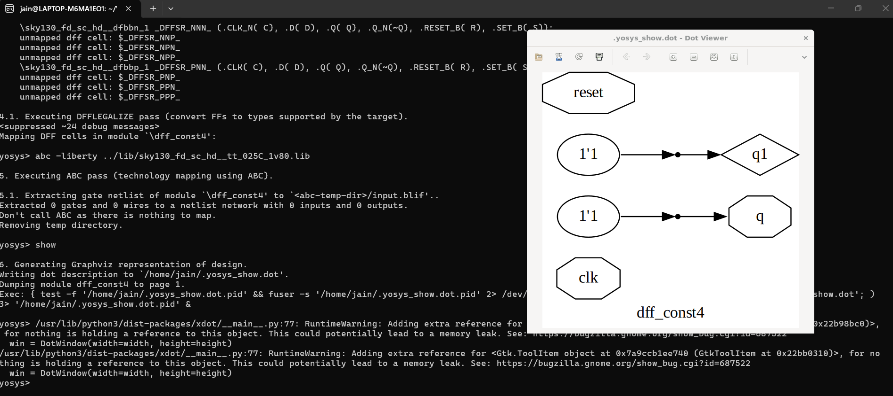

### 3.5 `dff_const5` – two flops, **both kept**
```verilog
module dff_const5(input clk, input reset, output reg q);
reg q1;
always @(posedge clk, posedge reset)
begin
    if (reset)
    begin
        q  <= 1'b0;
        q1 <= 1'b0;
    end
    else
    begin
        q1 <= 1'b1;
        q  <= q1;
    end
end
endmodule
```
Reset drives both `q` and `q1` to `0`. After reset is released, `q1` becomes `1` on the first clock edge, and `q` follows one cycle later. Q is `0` during reset and then goes to `1`, so it is **not** constant and the flops cannot be removed.

**SS 29.7** – source code in gvim, and synthesis statistics (2 × `$_DFF_PP0_` cells)

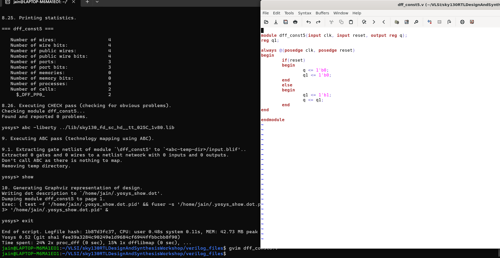

**SS 29.8** – waveform: Q stays 0 while reset = 1, and goes to 1 one clock cycle after reset is released (it is a 2-stage chain).

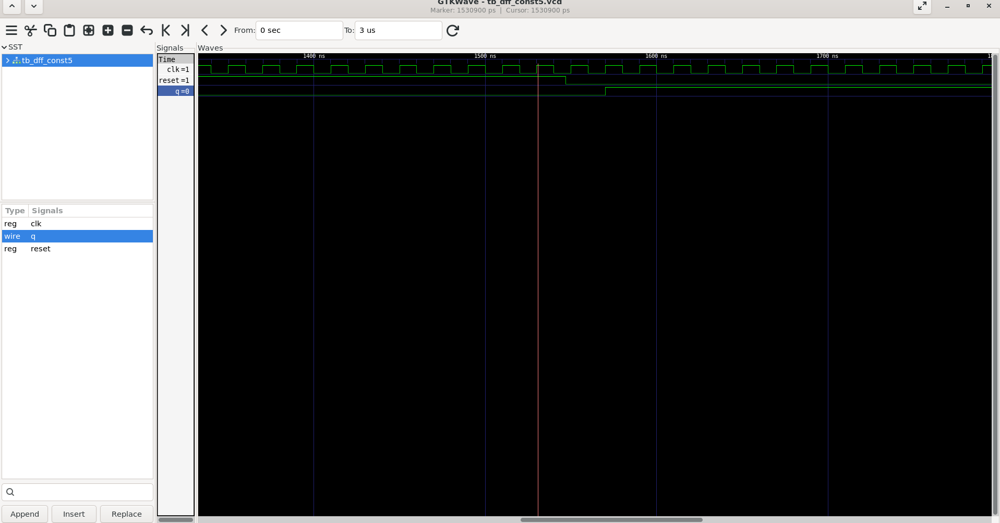

**SS 29.9** – synthesis: two `$_DFF_PP0_` flops in series (`q1` feeding `q`), both clocked by `clk` and reset by `reset`. They are generic cells because `dfflibmap` was not run, and ABC has no combinational logic to map.

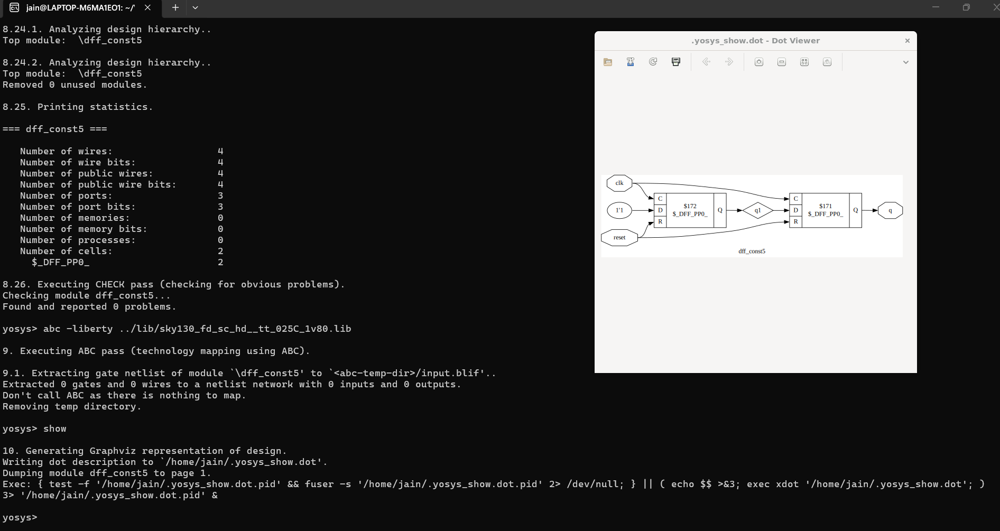

---

## 4. Unused Output Optimization (`counter_opt`)

A 3-bit up counter with synchronous count and async reset, where only some bits drive the output. Unused outputs `count[2]` and `count[1]` are optimized away if they do not affect `q`.

| Case | Output | Result |
|---|---|---|
| Case 1 | `q = count[0]` | Bits `[2]` and `[1]` are unused, so only one flop is needed |
| Case 2 | `q = (count[2:0] == 3'b100)` | All counter bits are used, so nothing can be removed |

### 4.1 Case 1: `counter_opt.v` (`q = count[0]`)
```verilog
module counter_opt (input clk, input reset, output q);
reg [2:0] count;
assign q = count[0];

always @(posedge clk, posedge reset)
begin
    if (reset)
        count <= 3'b000;
    else
        count <= count + 1;
end
endmodule
```
**SS 30.1** – source code

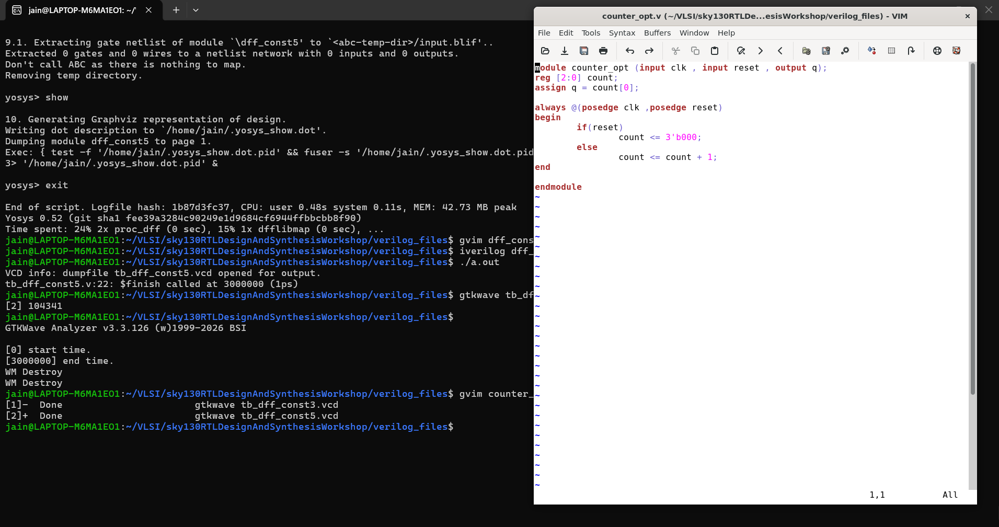

**Synthesis**
```
yosys
read_liberty -lib ../lib/sky130_fd_sc_hd__tt_025C_1v80.lib
read_verilog counter_opt.v
synth -top counter_opt
dfflibmap -liberty ../lib/sky130_fd_sc_hd__tt_025C_1v80.lib
abc -liberty ../lib/sky130_fd_sc_hd__tt_025C_1v80.lib
show
```
**SS 30.2** – only **one** `dfrtp_1` flop is used. ABC maps 2 `clkinv_1` cells: one inverts `reset` (for `RESET_B`) and one is the feedback inverter `D = Q'`. `count[2:1]` are unused and removed.

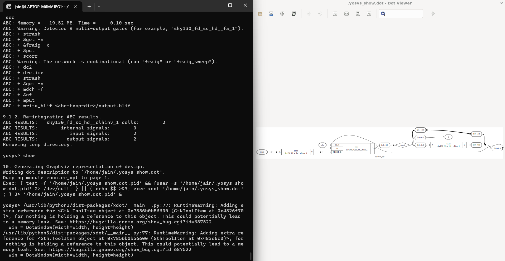

`count[0]` behaves as a toggle flop (D flop with its inverted output fed back to D):

```
count[0] --> NOT --> D --> Q = count[0] = q
```

### 4.2 Case 2: `counter_opt2.v` (`q = (count[2:0] == 3'b100)`)
```verilog
module counter_opt (input clk, input reset, output q);
reg [2:0] count;
assign q = (count[2:0] == 3'b100);

always @(posedge clk, posedge reset)
begin
    if (reset)
        count <= 3'b000;
    else
        count <= count + 1;
end
endmodule
```
**SS 31.1** – source code

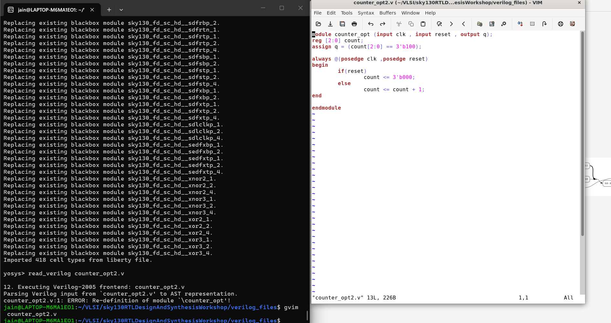

> Note: the module name in `counter_opt2.v` is still `counter_opt`, so reading it in the same Yosys session as `counter_opt.v` gives `ERROR: Re-definition of module '\counter_opt'` (visible in this screenshot). Restart Yosys (or rename the module) before synthesizing it.

**SS 31.2** – synthesis: all three counter bits are needed to decode `100`, so **three** `dfrtp_1` flops are kept, along with the incrementer logic (inverters, XOR/XNOR, NAND/NOR gates) and the decode gate that drives `q`. Nothing is optimized away.

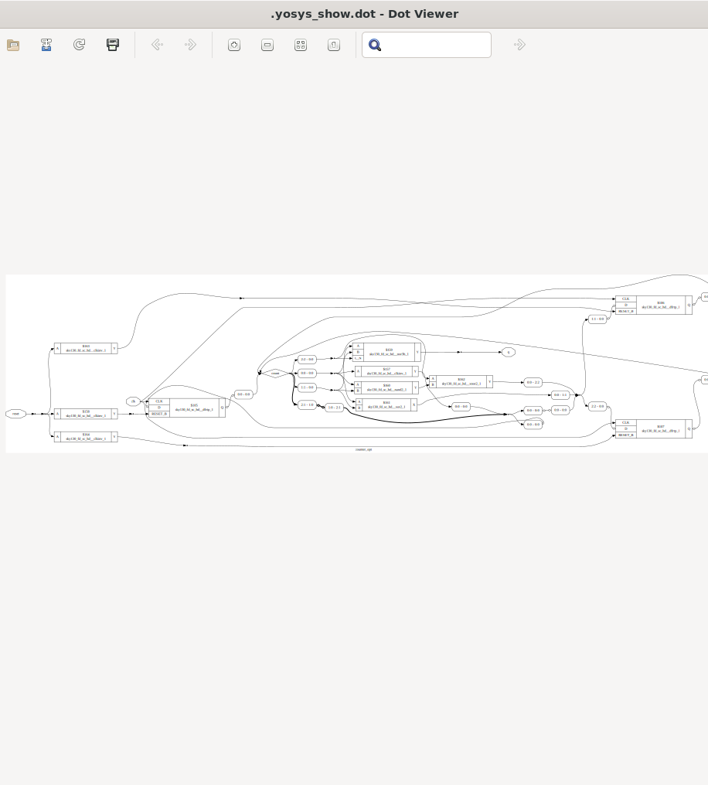

**Comparison:** with `q = count[0]` the design shrinks to 1 flop and 1 inverter, while `q = (count == 3'b100)` needs 3 flops plus combinational logic.

---

## 5. Yosys Command Reference

| Command | Purpose |
|---|---|
| `read_liberty -lib <lib>` | Read the standard cell library (as blackboxes) |
| `read_verilog <file>` | Read the RTL design |
| `synth -top <module>` | Run generic synthesis on the top module |
| `flatten` | Flatten module hierarchy |
| `opt_clean -purge` | Remove unused cells and wires |
| `dfflibmap -liberty <lib>` | Map flops to library flop cells (only needed if flops remain) |
| `abc -liberty <lib>` | Technology-map combinational logic |
| `show` | Show the netlist graph |
