# Optimization in Synthesis: `if`, `case`, Loops and Generate

Hands-on exploration of how conditional constructs (`if`, `case`), `for` loops and `generate` blocks in Verilog map to hardware, using **Icarus Verilog**, **GTKWave** and **Yosys** with the **SKY130** standard-cell library.

---

## Table of Contents

1. [Tool Flow](#tool-flow)
2. [If Statement](#1-if-statement)
3. [Case Statement](#2-case-statement)
4. [Incomplete `if` Labs](#3-incomplete-if-labs)
5. [Incomplete `case` Labs](#4-incomplete-case-labs)
6. [Complete `case` with `default`](#5-complete-case-with-default)
7. [Partial Assignment in `case`](#6-partial-assignment-in-case)
8. [Overlapping `case` (bad_case)](#7-overlapping-case-bad_case)
9. [`for` Loops and `generate`](#8-for-loops-and-generate)
10. [Mux using `generate`](#9-mux-using-for-generate)
11. [Demux using `generate`](#10-demux-using-for-generate)
12. [Ripple Carry Adder](#11-ripple-carry-adder-rca)
13. [Key Takeaways](#key-takeaways)

---

## Tool Flow

### RTL simulation

```bash
iverilog design.v tb_design.v
./a.out
gtkwave tb_design.vcd
```

### Synthesis (Yosys)

```bash
yosys
read_liberty -lib ../lib/sky130_fd_sc_hd__tt_025C_1v80.lib
read_verilog design.v
synth -top <module_name>
abc -liberty ../lib/sky130_fd_sc_hd__tt_025C_1v80.lib
show
```

### Gate Level Simulation (GLS)

```bash
iverilog ../my_lib/verilog_model/primitives.v ../my_lib/verilog_model/sky130_fd_sc_hd.v <netlist>.v tb_<design>.v
./a.out
gtkwave tb_<design>.vcd
```

---

## 1. If Statement

`if ... else if ... else` creates **priority logic**: the first condition has the highest priority and the chain is built as a cascade of 2:1 multiplexers.

```verilog
if (cond1)
    ...
else if (cond2)
    ...
else if (cond3)
    ...
else
    ...
```

### Danger: inferred latches

If the `if` chain is **incomplete** (no final `else`), the output has no defined value when none of the conditions are true. The synthesizer must retain the previous value, so it **infers a latch**. This is a bad coding style for combinational logic.

```verilog
if (cond1)
    y = a;
else if (cond2)
    y = b;
// no else -> y must hold its value -> latch inferred
```

### Where incomplete `if` is intentional: counters

In sequential logic (e.g. a counter), retaining the previous value is exactly what is wanted. An incomplete `if` here infers an enable on a flip-flop, not a latch:

```verilog
always @(posedge clk, posedge reset)
begin
    if (reset)
        count <= 3'b000;
    else if (en)
        count <= count + 1;
end
```

---

## 2. Case Statement

`if`, `case` are used **inside an `always` block**, and the variable being assigned must be a **`reg`**.

```verilog
case (sel)
    2'b00 : ...
    2'b01 : ...
    2'b10 : ...
    2'b11 : ...
endcase
```

### Caveats with `case`

| Caveat | Result |
|---|---|
| **Incomplete case** (not every `sel` value covered) | Inferred latches |
| **Partial assignment** (an output is not assigned in every branch) | Inferred latch on that output |
| **Overlapping case items** (e.g. `2'b10` and `2'b1?`) | Unpredictable / simulation-synthesis mismatch |

**Fix:** use a `default` branch and assign **all outputs in every branch**. Only one branch of a `case` may execute, so there should be no overlapping case items.

---

## 3. Incomplete `if` Labs

### Lab 1: `incomp_if.v`

```verilog
module incomp_if (input i0, input i1, input i2, output reg y);
always @(*)
begin
    if (i0)
        y <= i1;
end
endmodule
```

Open the files for editing:

```bash
gvim *incomp* -o
```

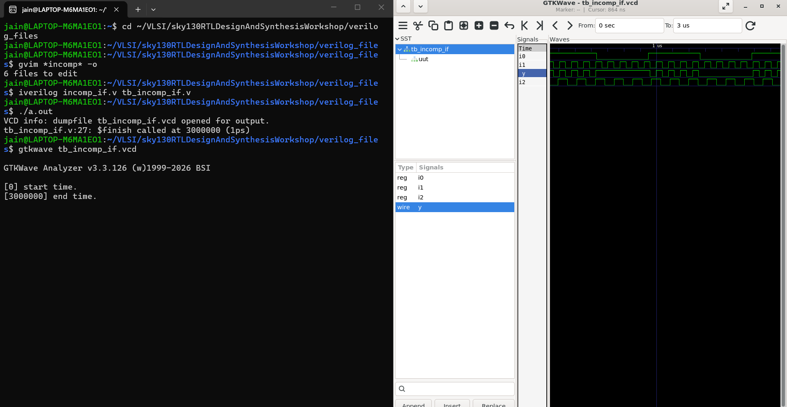

Simulate and view the waveform:

```bash
iverilog incomp_if.v tb_incomp_if.v
./a.out
gtkwave tb_incomp_if.vcd
```

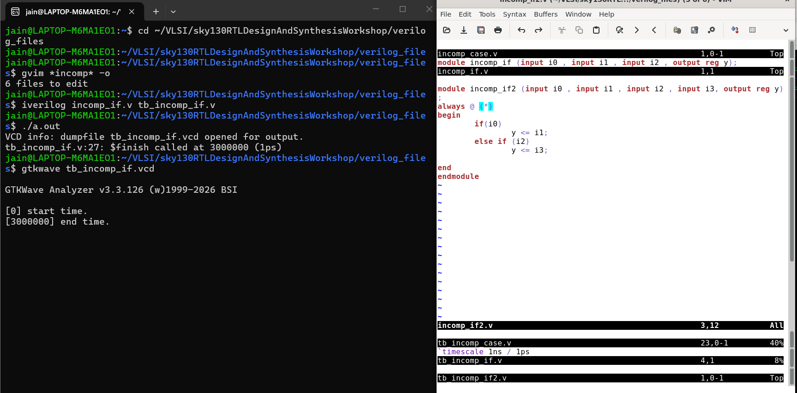

**Observation:** `y` follows `i1` only while `i0 = 1`. When `i0 = 0`, `y` **holds its previous value**, which is latch behaviour.

Synthesis with Yosys (`show`):

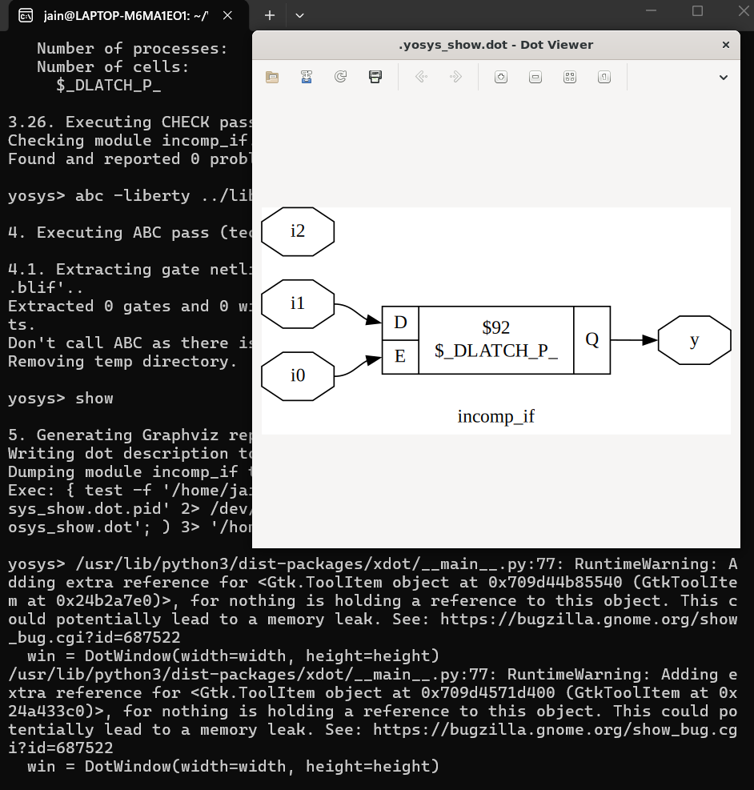

**Result:** a single `$_DLATCH_P_` with `D = i1` and `E = i0`. `i2` is unused. No other logic is generated.

---

### Lab 2: `incomp_if2.v`

```verilog
module incomp_if2 (input i0, input i1, input i2, input i3, output reg y);
always @(*)
begin
    if (i0)
        y <= i1;
    else if (i2)
        y <= i3;
end
endmodule
```

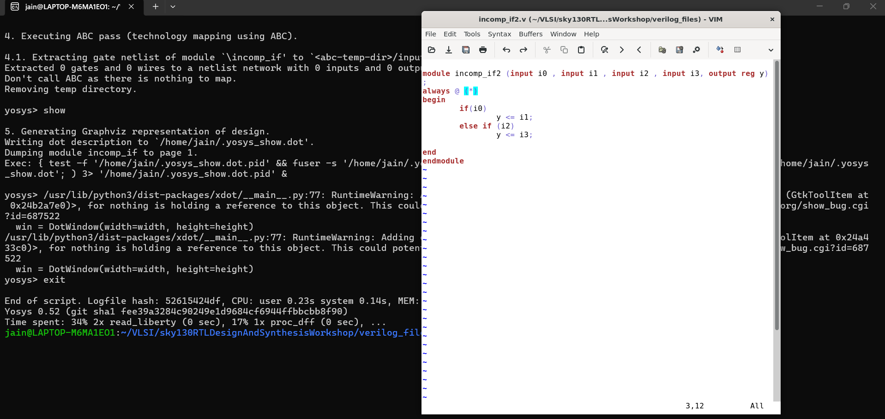

```bash
iverilog incomp_if2.v tb_incomp_if2.v
./a.out
gtkwave tb_incomp_if2.vcd
```

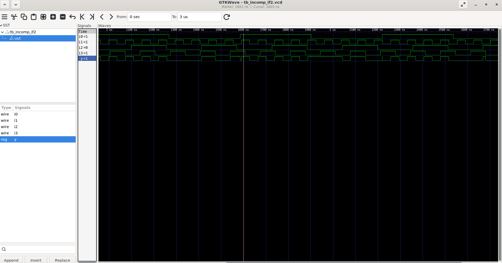

**Observation:** `y` follows `i1` when `i0 = 1`, follows `i3` when `i0 = 0` and `i2 = 1`, and **holds its value** when both `i0 = 0` and `i2 = 0`.

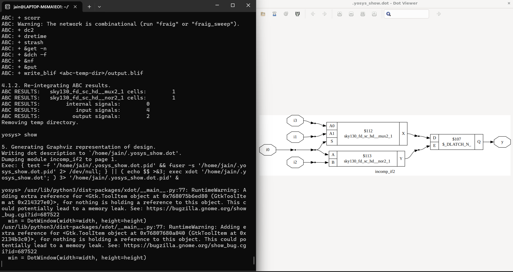

**Result:** a 2:1 mux (`sky130_fd_sc_hd__mux2_1`) selects between `i1` and `i3` using `i0`. A `nor2` of `i0` and `i2` drives the enable of a `$_DLATCH_N_` (transparent when `i0 + i2` is true). The latch is inferred because the `if` chain is incomplete.

---

## 4. Incomplete `case` Labs

### Lab 3: `incomp_case.v`

```verilog
module incomp_case (input i0, input i1, input i2, input [1:0] sel, output reg y);
always @(*)
begin
    case (sel)
        2'b00 : y = i0;
        2'b01 : y = i1;
    endcase
end
endmodule
```

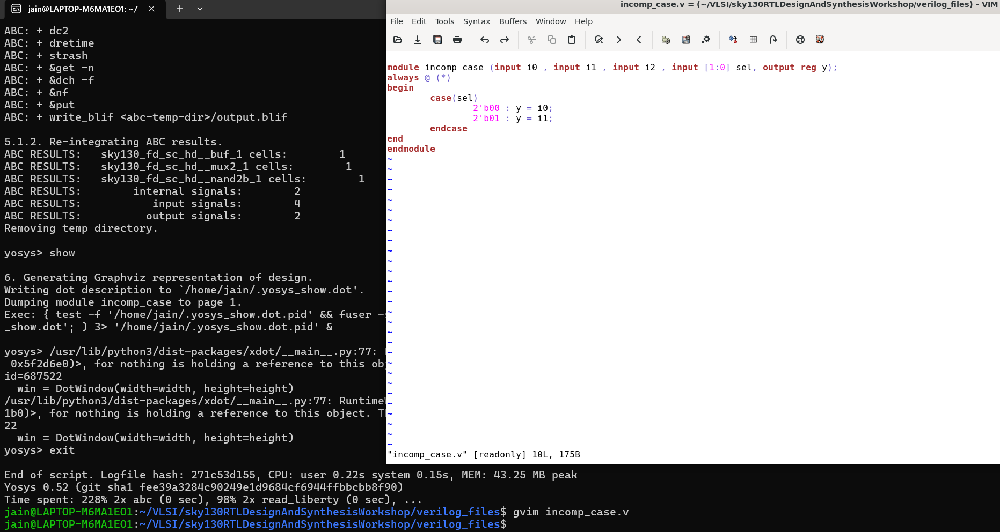

```bash
iverilog incomp_case.v tb_incomp_case.v
./a.out
gtkwave tb_incomp_case.vcd
```

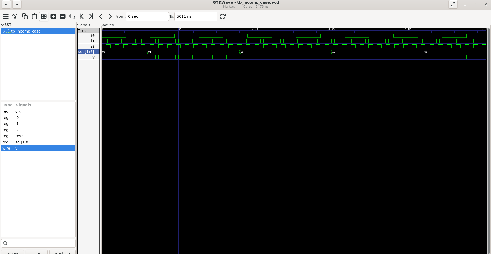

| `sel` | Behaviour of `y` |
|---|---|
| `00` | follows `i0` |
| `01` | follows `i1` |
| `10`, `11` | **latched** (holds previous value) |

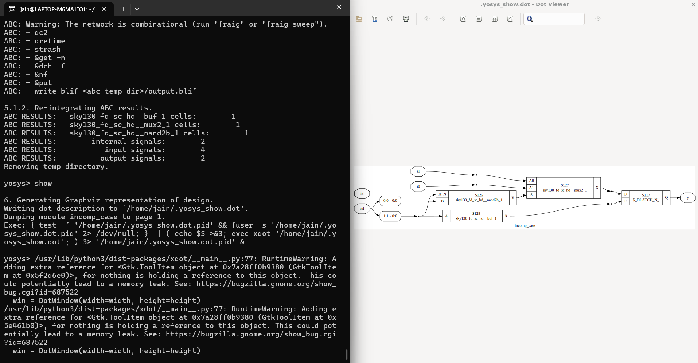

**Result:** a mux selects `i0` / `i1`, and the latch is enabled only when `sel[1] = 0`. The `sel[1]` input acts as the latch enable, so when `sel[1]` is `1` the latch holds.

---

## 5. Complete `case` with `default`

### Lab 4: `comp_case.v`

```verilog
module comp_case (input i0, input i1, input i2, input [1:0] sel, output reg y);
always @(*)
begin
    case (sel)
        2'b00   : y = i0;
        2'b01   : y = i1;
        default : y = i2;
    endcase
end
endmodule
```

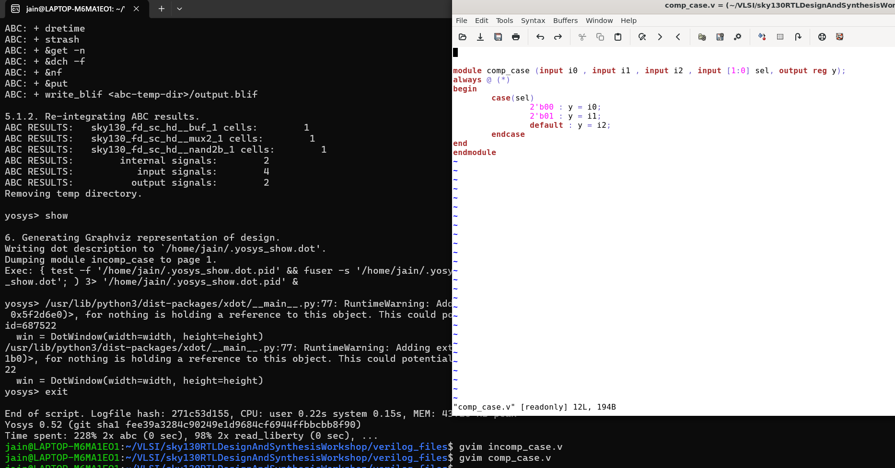

```bash
iverilog comp_case.v tb_comp_case.v
./a.out
gtkwave tb_comp_case.vcd
```


| `sel` | Behaviour of `y` |
|---|---|
| `00` | follows `i0` |
| `01` | follows `i1` |
| `10`, `11` | follows `i2` |

Synthesis:

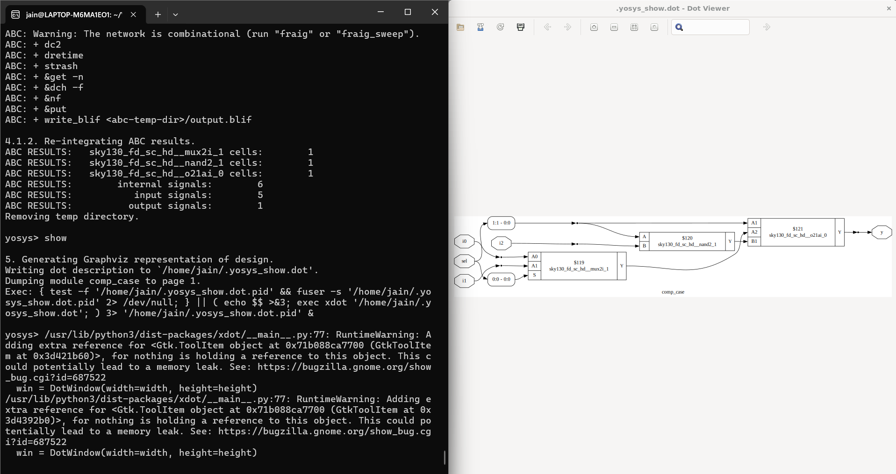

**Result:** purely combinational logic (`mux2i`, `nand2`, `o21ai`) and **no latch**. The `default` branch removes the inferred latch.

---

## 6. Partial Assignment in `case`

### Lab 5: `partial_case_assign.v`

```verilog
module partial_case_assign (input i0, input i1, input i2, input [1:0] sel,
                            output reg y, output reg x);
always @(*)
begin
    case (sel)
        2'b00 : begin
                    y = i0;
                    x = i2;
                end
        2'b01 : y = i1;          // x is NOT assigned here
        default : begin
                    x = i1;
                    y = i2;
                end
    endcase
end
endmodule
```

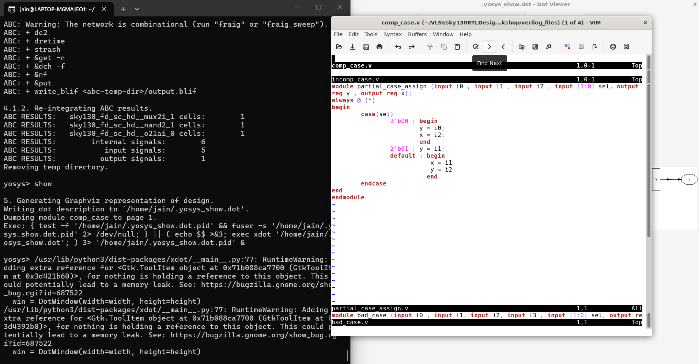

`y` is assigned in every branch, but `x` is **not assigned when `sel = 2'b01`**. So `x` must hold its old value in that case.

| `sel[1]` | `sel[0]` | Behaviour of `x` |
|---|---|---|
| 0 | 0 | follows `i2` |
| 0 | 1 | **latch (holds)** |
| 1 | 0 | follows `i1` |
| 1 | 1 | follows `i1` |

The latch enable condition is `sel[1] + sel[0]`.

```bash
read_verilog partial_case_assign.v
synth -top partial_case_assign
abc -liberty ../lib/sky130_fd_sc_hd__tt_025C_1v80.lib
show
```

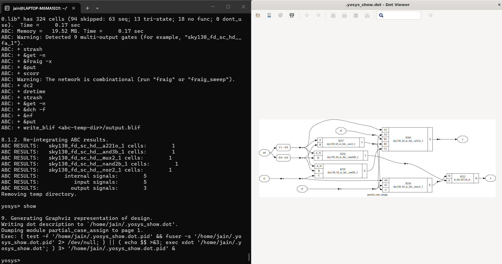

**Result:** `y` is built from combinational gates, while `x` goes through a `$_DLATCH_P_`. This confirms the latch is inferred only for the partially assigned output.

**Rule:** assign all outputs in all segments of the `case`.

---

## 7. Overlapping `case` (bad_case)

### Lab 6: `bad_case.v`

```verilog
module bad_case (input i0, input i1, input i2, input i3, input [1:0] sel, output reg y);
always @(*)
begin
    case (sel)
        2'b00: y = i0;
        2'b01: y = i1;
        2'b10: y = i2;
        2'b1?: y = i3;      // overlaps with 2'b10 (and 2'b11)
        //2'b11: y = i3;
    endcase
end
endmodule
```

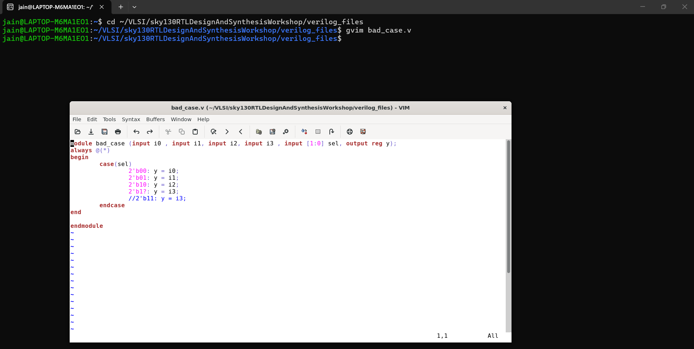

```bash
gvim bad_case.v
iverilog bad_case.v tb_bad_case.v
./a.out
gtkwave tb_bad_case.vcd
```

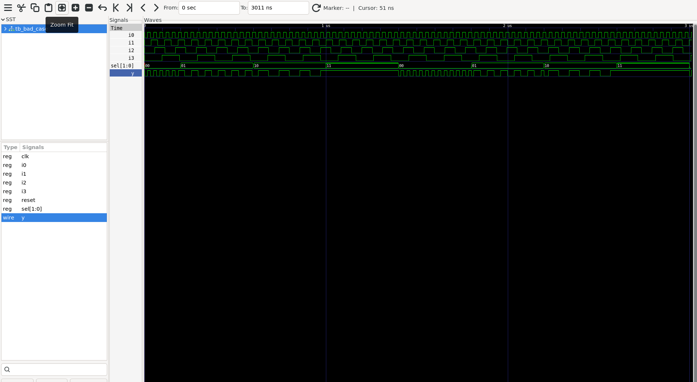

**RTL simulation:** when `sel = 11`, `y` becomes unpredictable (it neither follows `i1` nor `i3`). In simulation, the first matching case item wins, and the overlap makes `sel = 10` ambiguous between `i2` and `i3`.

Synthesis:

```bash
read_verilog bad_case.v
synth -top bad_case
abc -liberty ../lib/sky130_fd_sc_hd__tt_025C_1v80.lib
write_verilog -noattr bad_case_net.v
show
```

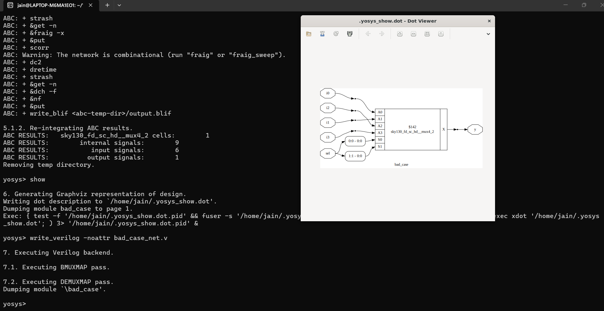

### Gate Level Simulation

```bash
iverilog ../my_lib/verilog_model/primitives.v ../my_lib/verilog_model/sky130_fd_sc_hd.v bad_case_net.v tb_bad_case.v
./a.out
gtkwave tb_bad_case.vcd
```

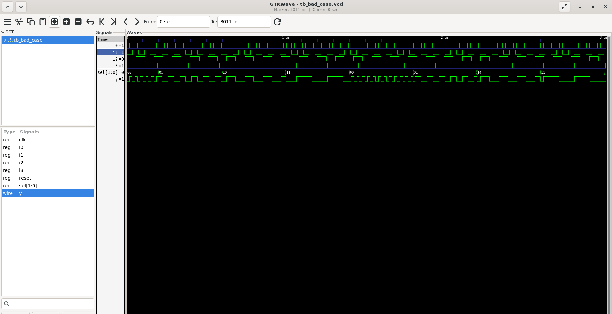

**Observation:**
- The synthesized netlist shows **no latching action**.
- The behaviour for `sel = 10` / `11` differs from RTL simulation (the tool does not get confused, but the result can be a **simulation vs synthesis mismatch**).
- Never write overlapping case items.

---

## 8. `for` Loops and `generate`

Two different loop constructs exist in Verilog:

| Construct | Where used | Purpose |
|---|---|---|
| `for` loop | **inside** `always` | **Evaluates** expressions; it does **not** instantiate hardware |
| `for-generate` | **outside** `always` | **Instantiates / replicates** hardware |

### Where `for` loops help

Large multiplexers and demultiplexers are tedious to write with `case`.

**2:1 mux**
```verilog
always @(*)
begin
    case (sel)
        1'b0 : y = i0;
        1'b1 : y = i1;
    endcase
end
```

**4:1 mux**
```verilog
always @(*)
begin
    case (sel)
        2'b00 : y = i0;
        2'b01 : y = i1;
        2'b10 : y = i2;
        2'b11 : y = i3;
    endcase
end
```

For a **32:1 mux** this would need 32 case items. A `for` loop is far shorter:

```verilog
always @(*)
begin
    for (i = 0; i < 32; i = i + 1)
    begin
        if (i == sel)
            y = inp[i];       // inp is [31:0]
    end
end
```

### `for` loop in a demux (1:8)

```verilog
always @(*)
begin
    op_bus[7:0] = 8'b0;
    for (i = 0; i < 8; i = i + 1)
    begin
        if (i == sel)
            op_bus[i] = input;
    end
end
```

Default every output to `0` first, then drive the selected one. This also avoids inferred latches.

### `for-generate`

Instantiating a piece of hardware multiple times manually:

```verilog
and u_and1 (.a(a[0]), .b(b[0]), .y(y[0]));
and u_and2 (.a(a[1]), .b(b[1]), .y(y[1]));
...
```

With `generate`, the same hardware is **replicated** by a loop:

```verilog
genvar i;
generate
    for (i = 0; i < 8; i = i + 1)
    begin
        and u_and (.a(a[i]), .b(in[i]), .y(y[i]));
    end
endgenerate
```

---

## 9. Mux using a `for` Loop

### Lab 7: `mux_generate.v`

A 4:1 mux whose four inputs (`i0 ... i3`) are packed into an internal bus `i_int`. A `for` loop (with loop variable `k`) inside an `always` block picks the input whose index equals `sel`.

```bash
gvim mux_generate.v
```

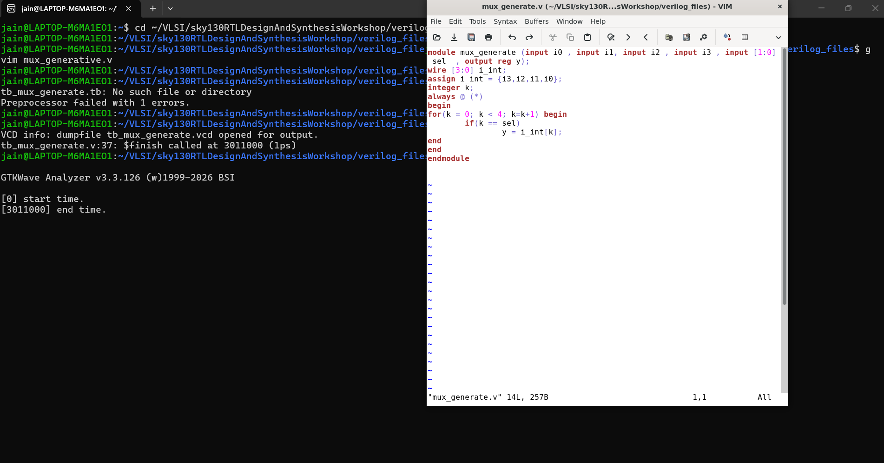

```bash
iverilog mux_generate.v tb_mux_generate.v
./a.out
gtkwave tb_mux_generate.vcd
```

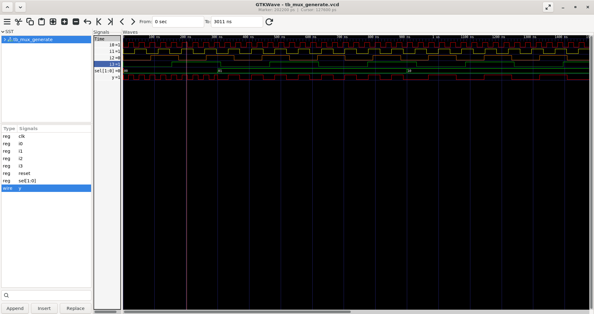

| `sel` | Output |
|---|---|
| 0 | `i0` follows to `y` |
| 1 | `i1` follows to `y` |
| 2 | `i2` follows to `y` |
| 3 | `i3` follows to `y` |

This is equivalent to the long form written with a `case` statement:

```verilog
case (sel)
    2'b00 : y = i0;
    2'b01 : y = i1;
    2'b10 : y = i2;
    2'b11 : y = i3;
endcase
```

### Synthesis

```bash
yosys
read_liberty -lib ../lib/sky130_fd_sc_hd__tt_025C_1v80.lib
read_verilog mux_generate.v
synth -top mux_generate
abc -liberty ../lib/sky130_fd_sc_hd__tt_025C_1v80.lib
show
```

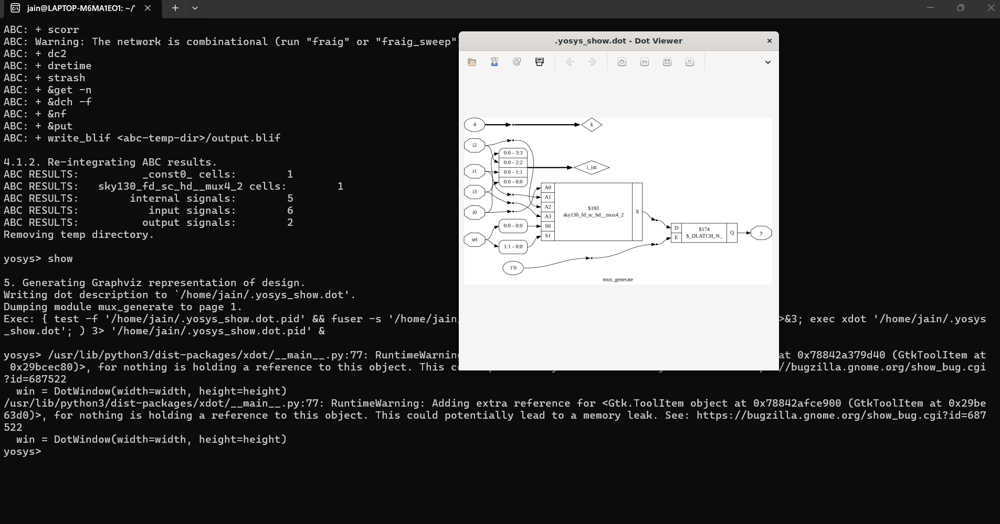

**Result:** the loop collapses into a single `sky130_fd_sc_hd__mux4_2`, with `sel[0]` and `sel[1]` driving `S0` and `S1` and `i_int[3:0]` on `A0 ... A3`. The loop variable `k` appears only as a constant and creates no hardware. The mux output goes through a `$_DLATCH_N_` whose enable is tied to a constant `0`, so the latch is always transparent.

---

## 10. Demux using `case` and `for` Loop

A 1:8 demultiplexer: input `i`, 3-bit `sel`, outputs `o0 ... o7`. The outputs are tied to an internal 8-bit bus: `assign {o7,o6,o5,o4,o3,o2,o1,o0} = y_int;`

### Lab 8a: `demux_case.v`

`y_int` is cleared to `8'b0` first, then the `case` statement drives only the selected bit. Every bit has a default value, so no latch is inferred.

```verilog
always @(*)
begin
    y_int = 8'b0;
    case (sel)
        3'b000 : y_int[0] = i;
        3'b001 : y_int[1] = i;
        3'b010 : y_int[2] = i;
        3'b011 : y_int[3] = i;
        3'b100 : y_int[4] = i;
        3'b101 : y_int[5] = i;
        3'b110 : y_int[6] = i;
        3'b111 : y_int[7] = i;
    endcase
end
```

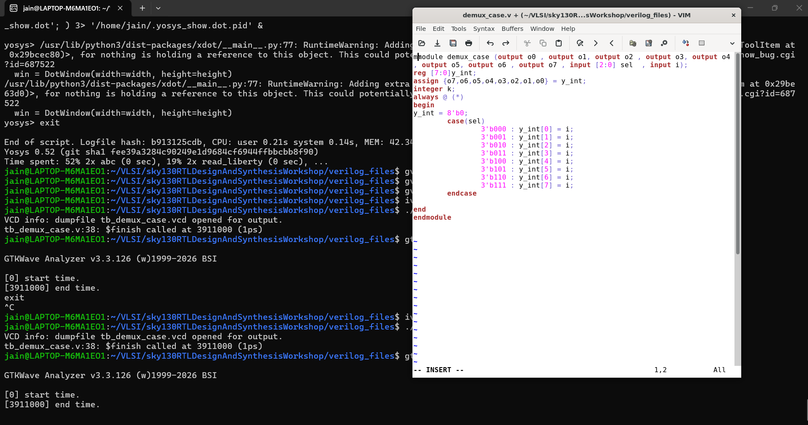

```bash
iverilog demux_case.v tb_demux_case.v
./a.out
gtkwave tb_demux_case.vcd
```

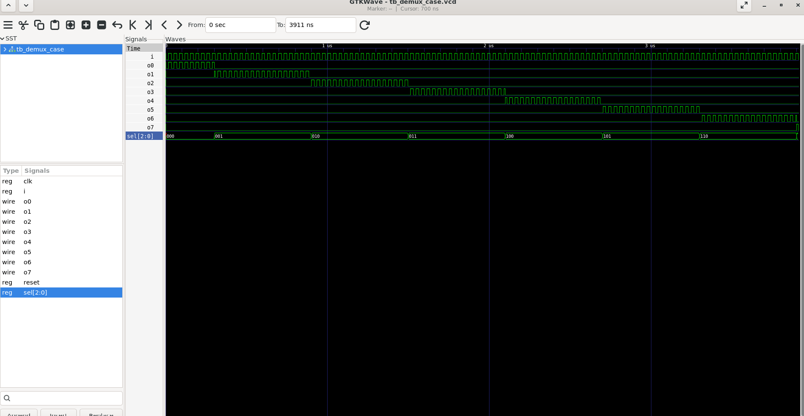

| `sel` | Behaviour |
|---|---|
| `000` | `o0` follows `i`, all others `0` |
| `001` | `o1` follows `i`, all others `0` |
| `010` | `o2` follows `i`, all others `0` |
| ... | ... |
| `111` | `o7` follows `i`, all others `0` |

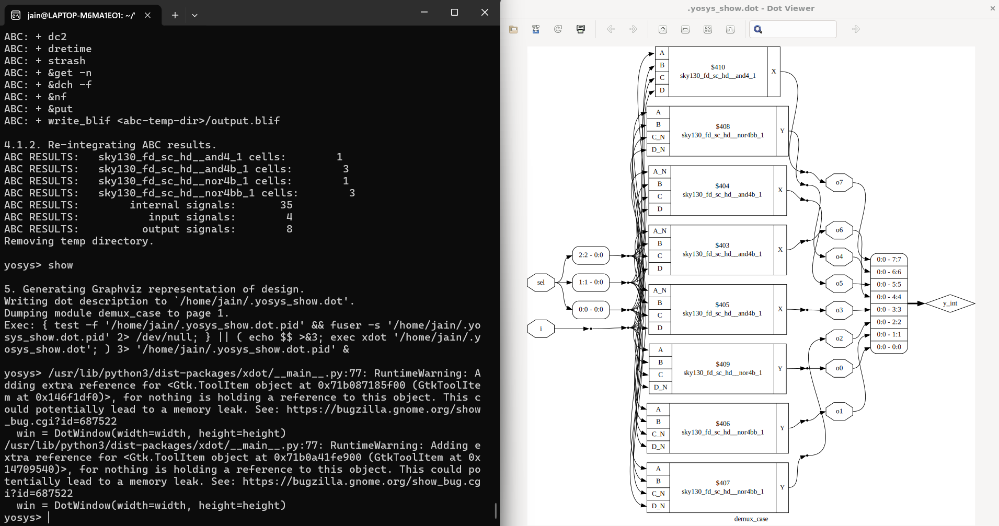

**Result:** `and4`, `and4b`, `nor4b` and `nor4bb` gates decode `sel` into the eight outputs (35 internal signals reported by ABC).

### Lab 8b: `demux_generate.v`

The same demux written with a `for` loop, which is much shorter.

```verilog
always @(*)
begin
    y_int = 8'b0;
    for (k = 0; k < 8; k = k + 1)
    begin
        if (k == sel)
            y_int[k] = i;
    end
end
```

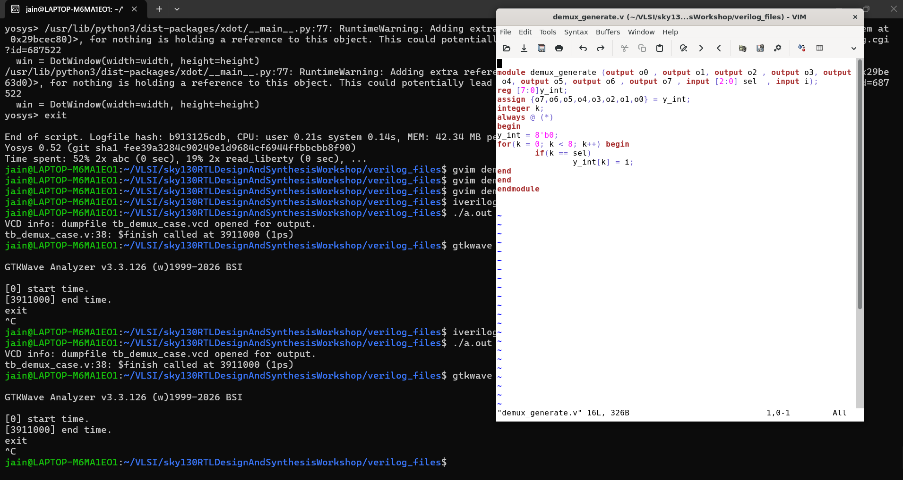

```bash
iverilog demux_generate.v tb_demux_generate.v
./a.out
gtkwave tb_demux_generate.vcd
```

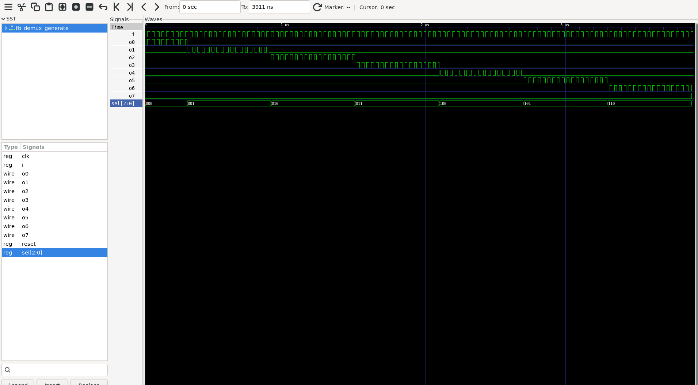

The waveform is identical to the `case` version: `o0 ... o7` follow `i` one after another as `sel` goes from `000` to `110` (and then `111`).

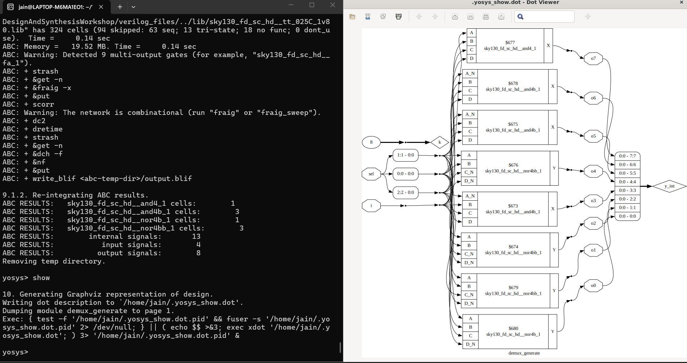

**Result:** the same kind of decoder gates (`and4`, `and4b`, `nor4b`, `nor4bb`) are generated, but ABC reports only **13 internal signals** instead of 35. The loop version is shorter to write and synthesizes to a smaller netlist than the 8-item `case`.

---

## 11. Ripple Carry Adder (RCA)

A ripple carry adder adds two numbers using a chain of **full adders (FA)**. The carry-out of each stage feeds the carry-in of the next stage, so the carry "ripples" through the chain.

```
    a3 a2 a1 a0
 +  b3 b2 b1 b0
 ---------------
 c3 s3 s2 s1 s0
```

Each FA takes `(a_i, b_i, c_i)` and produces `(sum_i, c_{i+1})`.

**Rule of addition**

| Operands | Result width |
|---|---|
| `N-bit + N-bit` | `N+1` bits |
| `N-bit + M-bit` | `max(N, M) + 1` bits |

### Lab 9: `fa.v` and `rca.v`

The full adder is written once:

```verilog
module fa (input a, input b, input c, output co, output sum);
    assign {co, sum} = a + b + c;
endmodule
```

The 8-bit adder uses **`for-generate`** to replicate the full adder for bits 1 to 7. Bit 0 is instantiated separately with carry-in `1'b0`. The final carry-out becomes `sum[8]`.

```verilog
module rca (input [7:0] num1, input [7:0] num2, output [8:0] sum);
wire [7:0] int_sum;
wire [7:0] int_co;

genvar i;
generate
    for (i = 1; i < 8; i = i + 1)
    begin
        fa u_fa_1 (.a(num1[i]), .b(num2[i]), .c(int_co[i-1]),
                   .co(int_co[i]), .sum(int_sum[i]));
    end
endgenerate

fa u_fa_0 (.a(num1[0]), .b(num2[0]), .c(1'b0),
           .co(int_co[0]), .sum(int_sum[0]));

assign sum[7:0] = int_sum;
assign sum[8]   = int_co[7];
endmodule
```

```bash
gvim rca.v fa.v
```

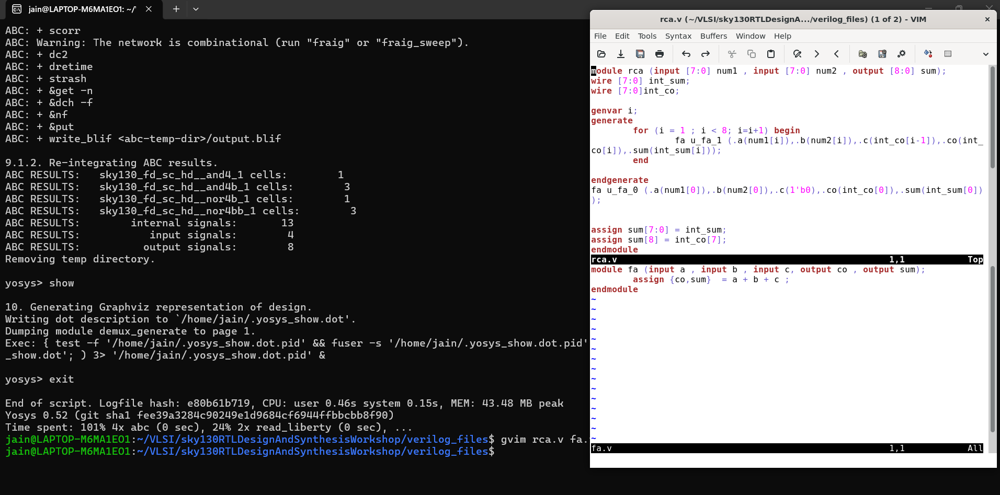

### RTL simulation

```bash
iverilog fa.v rca.v tb_rca.v
./a.out
gtkwave tb_rca.vcd
```

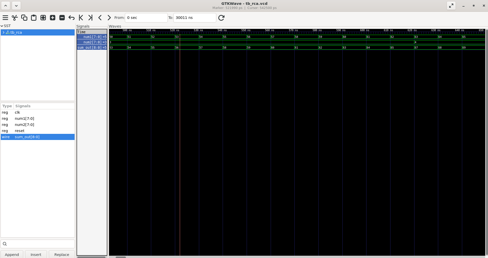

**Observation:** `sum_out = num1 + num2`. For example, with `num2 = 3`, `num1 = 50` gives `sum_out = 53`, and `num1 = 51` gives `54`. When `num2` changes to `4` the sum steps accordingly (`num1 = 63` gives `67`).

### Synthesis

```bash
yosys
read_liberty -lib ../lib/sky130_fd_sc_hd__tt_025C_1v80.lib
read_verilog fa.v rca.v
synth -top rca
abc -liberty ../lib/sky130_fd_sc_hd__tt_025C_1v80.lib
show rca
```

> Use `show rca` (not plain `show`). With more than one module in the design, plain `show` fails with *"only one module must be selected"*.

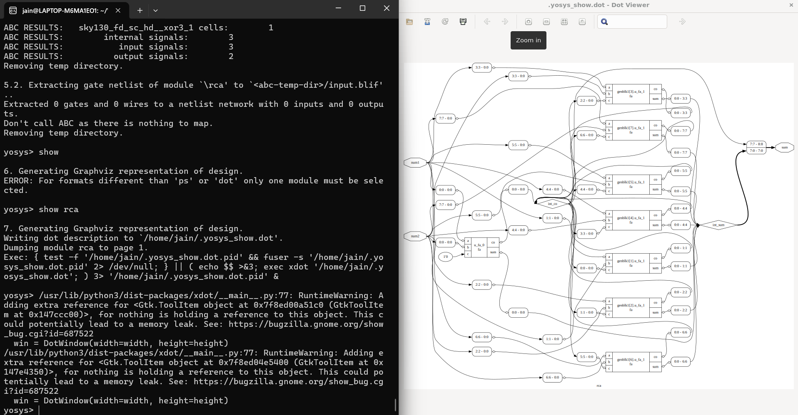

**Result:** eight `fa` instances (`u_fa_0` and `genblk1[1] ... genblk1[7]`) are chained through `int_co`, with `int_sum` collecting the sum bits and `sum[8]` taken from the last carry. This shows that `for-generate` replicates the hardware.

### Gate Level Simulation

```bash
write_verilog -noattr rca_net.v
iverilog ../my_lib/verilog_model/primitives.v ../my_lib/verilog_model/sky130_fd_sc_hd.v rca_net.v tb_rca.v
./a.out
gtkwave tb_rca.vcd
```

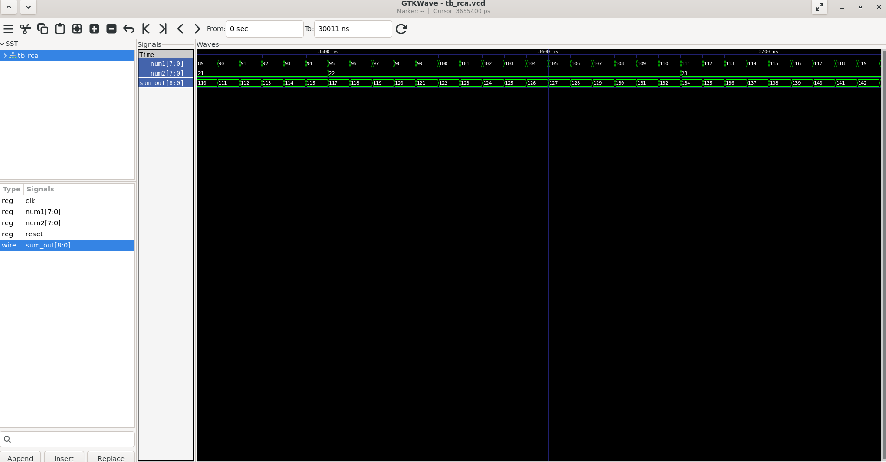

**Observation:** the gate-level waveform shows the same behaviour as RTL (for example `num1 = 89`, `num2 = 21` gives `sum_out = 110`), confirming that the synthesized netlist matches the RTL.

---

## Key Takeaways

- An **incomplete `if`** or **incomplete `case`** in combinational logic creates **inferred latches**.
- Always use a final **`else`** or a **`default`** branch.
- In a `case`, **assign every output in every branch** to avoid partial-assignment latches.
- **Avoid overlapping case items**; they can cause simulation / synthesis mismatches.
- A `for` loop **inside `always`** evaluates expressions (it does not create hardware instances), while **`for-generate`** replicates hardware.
- Loops make large muxes/demuxes compact and readable.
- Incomplete `if` is acceptable in **sequential logic** (counters, enables), where it infers a flip-flop enable.
- Always verify with **GLS**: compare the synthesized netlist behaviour with RTL simulation.

---

## Tools Used

| Tool | Purpose |
|---|---|
| Icarus Verilog (`iverilog`) | RTL and gate-level simulation |
| GTKWave | Waveform viewing |
| Yosys | Logic synthesis |
| ABC | Technology mapping |
| SKY130 `sky130_fd_sc_hd` | Standard-cell library |
| gVim | Code editing |
